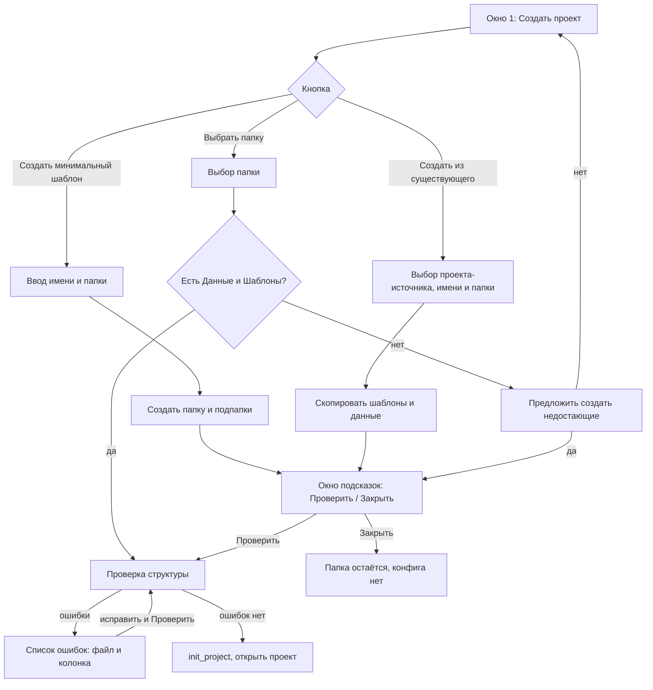

# Спецификация: 024-project-quick-create — Упрощённое создание проекта

**Статус:** active
**Версия:** 0.2.0-alpha
**Зависит от:** 014-project-create (init_project), 022-import-export (разбор папки), 021-counters (формат PJ)
**FR:** FR-12, FR-13
**NFR:** NFR-3, NFR-4

## 1. Цель

Создание проекта сейчас требует пяти решений в одном окне: имя, родительская
папка, список xlsx, список docx и флажок «копировать». Пользователь чаще
готовит файлы в папках, чем выбирает их в диалоге. Поэтому создание делится на
два шага:

1. программа создаёт папку проекта с подпапками, пользователь кладёт туда файлы;
2. программа проверяет структуру и содержимое и только после этого создаёт
   проект (конфиг в Home) через существующий `init_project`.

Проверка одна и та же для всех путей входа.

## 2. Входы

Первое окно (вызывается кнопкой создания в окне 1):

- описание: что такое папка проекта и какие подпапки в ней нужны;
- кнопка **«Создать минимальный шаблон»**;
- кнопка **«Выбрать готовую папку»**;
- кнопка **«Создать из существующего проекта»**;

> Примечание: в окне 022 «Выбрать папку» уже есть в окне «Открыть проект»
> (импорт `*.stanok` или создание из папки). Новое окно использует ту же
> проверку структуры, но его кнопка открывает самостоятельный путь.



## 3. Контракт

### 3.1 Создание минимального шаблона

- Пользователь вводит имя проекта и выбирает базовую папку.
- Создаются папка `<база>/<имя>` и подпапки `Данные`, `Шаблоны`, `Результат`.
- Имя проверяется: занято в Home → ошибка, не создавать папку.
- Конфиг в Home не создаётся. Проект ещё не существует для программы.
- Открывается окно подсказок (см. 3.4).

### 3.2 Выбор папки

- Пользователь выбирает папку.
- Если в папке нет `Данные` или `Шаблоны`, программа предлагает создать
  недостающие подпапки. При отказе окно остаётся открытым.
- Если папка с конфигом в Home уже есть (по имени папки), открывается
  существующий проект, а не создаётся новый.
- Иначе запускается проверка структуры (3.5).

### 3.3 Создание из существующего проекта

- Пользователь выбирает проект-источник (из списка Home), имя и базовую папку.
- Копируются `Шаблоны/` и `Данные/` источника. Папка `Результат` создаётся пустой.
- Конфиг источника не копируется. Поля, счётчики и имя создаются заново через
  проверку и `init_project`.
- Дальше — окно подсказок (3.4), как у минимального шаблона.

### 3.4 Окно подсказок

- Текст: что положить в `Шаблоны` (docx с `{{поле}}`), что в `Данные` (xlsx
  с заголовками в первой строке, имена колонок совпадают с полями).
- Кнопки: **«Проверить»** и **«Закрыть»**.
- «Закрыть» ничего не удаляет. Папка остаётся, конфига нет.

### 3.5 Проверка структуры

Новая функция, без GUI, возвращает список ошибок и предупреждений:

```python
check_project_structure(folder: Path, name: str, store: ProjectStore) -> ProjectCheck

ProjectCheck:
    errors: list[CheckIssue]     # блокируют создание
    warnings: list[CheckIssue]   # создание возможно
    xlsx: list[str]              # Данные/*.xlsx, относительные пути
    docx: list[str]              # Шаблоны/*.docx, относительные пути

CheckIssue:
    file: str                    # путь относительно папки проекта
    column: str | None           # колонка или плейсхолдер, если есть
    message: str                 # текст из strings.py
```

**Ошибки (блокируют создание):**

| Условие | Пример сообщения |
|---|---|
| нет подпапки `Данные` или `Шаблоны` | «Нет папки Данные» (с кнопкой «Создать») |
| в `Шаблоны` нет docx | «В папке Шаблоны нет .docx» |
| в `Данные` нет xlsx | «В папке Данные нет .xlsx» |
| в docx нет ни одного `{{поля}}` | «Шаблон Договор.docx: нет полей {{…}}» |
| в xlsx нет строки заголовков | «Клиенты.xlsx: нет заголовков» |
| дубли заголовков в xlsx | «Клиенты.xlsx: повтор колонки Имя» |
| имя проекта занято в Home | «Проект «Имя» уже существует» |

Сверка плейсхолдеров с колонками в проверку не входит. Проверка не привязывает
поля к колонкам и не сообщает о несовпадениях. Это ответственность окна полей
(окно 3): там поля сверяются с колонками и привязываются к источнику. По
умолчанию привязка идёт к первому xlsx, как в `init_project`. Если колонки нет,
проект создаётся, а ошибка видна в окне полей и при генерации
(`column ... not found`).

**Предупреждения (создание возможно):**

| Условие | Пример сообщения |
|---|---|
| xlsx без строк данных | «Клиенты.xlsx: нет строк данных» |
| docx с плейсхолдерами, которые не распознаны (например, пустые) | «Договор.docx: пустой плейсхолдер {{ }}» |

Каждая ошибка указывает файл и колонку (если применимо). Список показывается
целиком; после исправления пользователь нажимает «Проверить» и проверка
запускается заново.

### 3.6 Создание проекта после проверки

Если ошибок нет:

```python
store.init_project(folder, name, xlsx=check.xlsx, docx=check.docx, copy_files=False)
```

- `copy_files=False`: файлы уже лежат в `Данные` и `Шаблоны`, копирование не нужно.
- Флажок «копировать» из окна создания убирается.
- После успеха открывается окно проекта с подсветкой нового (как сейчас).

### 3.7 Имя проекта

Имя проверяется дважды: при создании папки (3.1, 3.3) и при «Проверить» (3.5).
Между шагами имя могло быть занято, поэтому вторая проверка обязательна.

### 3.8 Незавершённое состояние

- После 3.1 или 3.3 на диске есть папка без конфига. Это допустимое состояние.
- Программа не удаляет такую папку сама.
- Пользователь возвращается к ней через «Выбрать папку» (3.2): проверка
  подхватывает папку как есть.
- В окне 1 такие папки не показываются в списке «недавних», пока не созданы.

## 4. Тексты

Все строки окон, подсказок и сообщений проверки добавляются в
`src/stanok/gui/strings.py`. Литералов на русском в коде окон нет (правило
AGENTS.md).

## 5. Вне объёма

- Редактирование полей и привязки после создания (окно 3, без изменений).
- Переименование проекта.
- Удаление старого окна создания в режиме «создать»: удаляется в фазе 4 плана.
  Режим настроек (edit_ref) в `CreateDialog` сохраняется.

## 6. Критерии приёмки

- Минимальный шаблон создаёт три подпапки и не создаёт конфиг.
- «Закрыть» не удаляет папку; «Выбрать папку» на ней проходит проверку.
- Проверка возвращает ошибки и предупреждения только по структуре и заголовкам файлов (таблица 3.5), с указанием файла и колонки, где это применимо.
- Проверка не сверяет поля с колонками: это делает окно полей (окно 3).
- Исправление файла и повторная проверка проходят без перезапуска окна.
- Успешная проверка создаёт проект тем же `init_project`, что и сейчас, без копирования.
- Имя, занятое между шагами, блокирует создание на повторной проверке.
- Тесты проверки работают без GUI; тесты окон — через `QT_QPA_PLATFORM=offscreen`.
