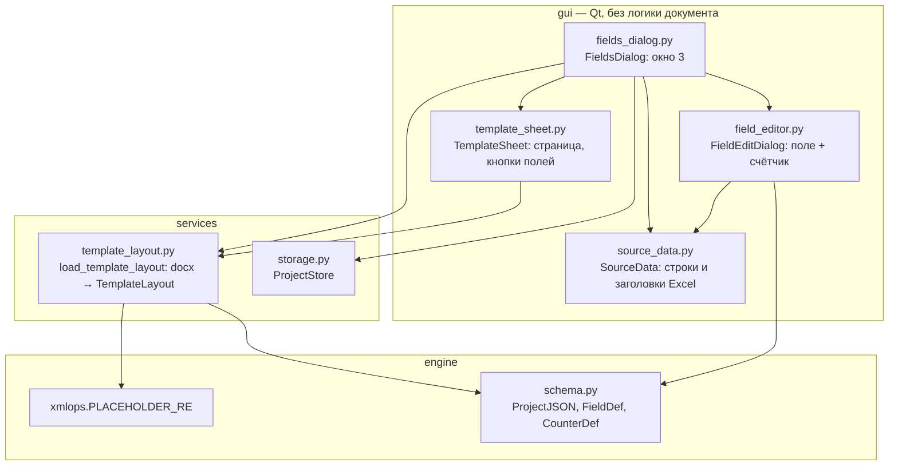

# План: 027-full-screen-template

**Spec:** [spec.md](spec.md)

## 1. Архитектура

Слои: `gui → services → engine`. Раскладку документа строит `services`
(python-docx уже используется в services и engine). Окно только рисует её.



## 2. Модели раскладки (`services/template_layout.py`)

```text
TemplateLayout(width_pt, height_pt, margins, header: [Block], body: [Block], footer: [Block])
Block = Paragraph | Table
Paragraph(align, left_pt, right_pt, first_pt, before_pt, after_pt, page_break_before, pieces, default_pt)
Piece = Text(text, style) | Field(name, style) | LineBreak | PageBreak
Table(col_widths_pt, rows: [[Cell]], borders)
Cell(span, blocks)
Style(bold, italic, underline, size_pt, font)
```

Разбор абзаца:

1. Атомы: символы run'ов с их стилем; `w:br` → `\n` (или `\f` для страницы), `w:tab` → `\t`.
2. Склейка текста и поиск `PLACEHOLDER_RE` (тот же regex, что в `xmlops`).
   Поиск по склеенному тексту — то же, что делает `substitute_paragraph`, поэтому поле,
   разбитое на несколько run'ов, видно как одно поле.
3. Куски (pieces): соседние символы с одним стилем — один `Text`; совпадение — `Field`.
4. Наследование стиля: run → абзац → цепочка `based_on` стиля → `docDefaults` → 11 pt.

Обход тела документа идёт по XML (`w:body`), а не по `doc.paragraphs` и
`doc.tables` отдельно: порядок абзацев и таблиц сохраняется.

## 3. Окно 3 (`fields_dialog.py`)

- Окно разворачивается (`Qt.WindowMaximized`) в `__init__`.
- Верх: «Имя файла» и «Вставить поле» (как раньше).
- Центр: `QScrollArea` со `TemplateSheet`. Нижняя часть страницы — список полей, которых нет в документе.
- Низ: «Сохранить» (виден после изменения) и «Закрыть».
- `FieldsDialog` держит `_pj` (живой проект), `_shared` (сквозные счётчики), `_source` (`SourceData`).
- Таблица полей и таблица счётчиков (`table`, `ctable`, `_rows`, `_crows`, `_build_counters_table`) удаляются.
- Сохранение: `validate_pj` + `store.save` — как раньше; проверка полей переехала в редактор.

## 4. Редактор поля (`field_editor.py`)

- Один диалог на одно поле. Работает с `pj` окна 3 напрямую (живой объект).
- Тип и значение — как в старой строке таблицы (`_build_value_cell`).
- Для `table` и `counter` — блок счётчика: комбобокс счётчика, «+» (создать), источник
  (только проектный счётчик), формат, позиция (с «глазом» выбора строки), «Заново»,
  «Удалить счётчик» (если без источника и не используется другими полями).
- Сквозной счётчик: блок только для чтения, текст «Настраивается в окне «Сквозные счётчики»».
- OK переносит поле и параметры счётчика в `pj`, `changed = True`.
  Отмена не меняет поле; создание/удаление счётчика — сразу в `pj` (как раньше), поэтому `changed` выставляется и при отмене.

## 5. Кнопка поля и подсказка

`TemplateSheet` получает `configured(name) -> bool` и текстовое описание поля
(`describe(name) -> str`) от окна. Кнопка: `objectName = "fieldButton"`, свойство
`configured` (QSS-правило для «не настроено»). Клик — сигнал `fieldClicked(str)`.

## 6. Раскладка в виджеты (`template_sheet.py`)

- Страница: `QFrame#sheet`, ширина = ширина страницы из sectPr (96 dpi), минимальная
  высота = высота страницы; поля = отступы страницы.
- Абзац → `QVBoxLayout` строк; строка → `FlowLayout` со словами и кнопками.
  Пробелы — отдельные spacer'ы нужной ширины (ширина пробела шрифта текущего run'а).
- Выравнивание строки: `center`/`right` — сдвиг строки; `first_pt` — отступ первой строки абзаца.
- Таблица → `QGridLayout`, ширины колонок — `setColumnStretch` по `col_widths_pt`, объединение через `colspan`.
- `PageBreak` и `page_break_before` — горизонтальная пунктирная линия с подписью.
- Колонтитулы — блоки с серым фоном и подписью «Верхний колонтитул» / «Нижний колонтитул»; пустые колонтитулы не выводятся.

## 7. Тесты

- `tests/services/test_template_layout.py`: выравнивание, отступы, интервалы, наследование стиля, `w:br`, `w:br type=page`, поле через несколько run'ов, таблица с gridSpan и рамками, колонтитулы, пустой абзац.
- `tests/gui/test_template_sheet.py`: кнопка на каждое поле, клик → сигнал, строки по `\n`, выравнивание, таблица, колонтитулы, пустой абзац. Offscreen.
- `tests/gui/test_field_editor.py`: каждый тип, таблица без столбца → ошибка, OK переносит параметры, отмена не меняет, создание/удаление счётчика, сквозной только чтение.
- `tests/gui/test_fields_dialog.py`: переписан: максимизация, кнопки полей, поля вне документа, сохранение, dirty, отсутствующий шаблон.
- Обновить `test_global_counters.py`, `test_integration.py`, `test_project_dialog.py` под новое окно.

Проверка на экране: `QScreen.grabWindow(0)` (offscreen на этой машине не рисует текст).

## 8. Миграция

Не нужна: формат `<имя>.stanok` не меняется.

## 9. Этапы

Смотри [tasks.md](tasks.md).
