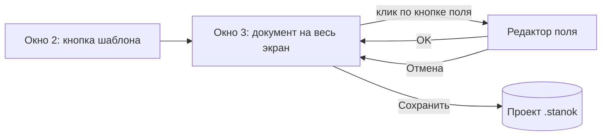

# Спецификация: 027-full-screen-template — Шаблон на весь экран

**Статус:** active (дополнение: правка текста)
**Версия:** 0.4.0-alpha (следующий релиз)
**Зависит от:** 010-gui-fields (окно 3), 021-counters (счётчики на источники), 026-shared-counters (сквозные счётчики)
**FR:** FR-2, FR-3, FR-18 (новый), FR-19 (новый), FR-20 (новый)
**NFR:** NFR-3, NFR-4, NFR-5

## 1. Цель

Заполнение шаблона сейчас выглядит как таблица: строка на каждое поле, отдельная
таблица счётчиков и ряд комбобоксов. Пользователь видит абстрактные имена
полей и не понимает, где каждое из них стоит в документе. Таблица счётчиков
отделена от полей, которые её используют.

Новое окно 3 показывает сам документ. Поля стоят на своих местах в тексте и
выглядят как кнопки с именем поля. Нажатие на кнопку открывает редактор этого
поля, а для полей-таблиц — и редактор их счётчика. Общая таблица полей и общая
таблица счётчиков исчезают.

## 2. Входы и выходы

Вход: окно 2 (проект), кнопка шаблона → окно 3 (`FieldsDialog`).

Выход: проект в памяти, сохранённый кнопкой «Сохранить» окна 3 (как раньше).
Формат проекта (`<имя>.stanok`) не меняется, миграция не нужна.

## 3. Требования

### 3.1 Функциональные

| ID | Требование | Приоритет |
|----|------------|-----------|
| FR-18 | Окно 3 открывается на весь экран и показывает документ шаблона как страницу: выравнивание абзацев, отступы, интервалы, принудительные разрывы строк и страниц, таблицы, верхний и нижний колонтитулы | Must |
| FR-19 | Каждое поле шаблона (в теле, таблицах и колонтитулах) показано кнопкой с именем поля; клик открывает редактор поля | Must |
| FR-20 | Редактор поля: тип (константа, таблица, счётчик, дата), значение; для поля-таблицы или поля-счётчика — параметры счётчика (источник, формат, позиция, «Заново»), создание и удаление счётчика | Must |
| FR-21 | Общая таблица полей и общая таблица счётчиков в окне 3 не показываются | Must |
| FR-22 | Кнопка поля, у которого ещё нет настройки, отличается от настроенного; поля проекта, которых нет в документе, перечислены отдельно и доступны для редактирования | Should |
| FR-23 | Сквозной счётчик в редакторе поля — только чтение формата и позиции; изменяется в окне 1 «Сквозные счётчики» | Must |
| FR-24 | Правка текста шаблона в окне 3: двойной щелчок по абзацу открывает редактор текста. Печатать, удалять и разрывать строки можно; поля-кнопки остаются полями, пока их текст `{{…}}` не удалён | Must |
| FR-25 | Сохранение правки текста — в тот же `.docx` при «Сохранить». Перед записью старая версия копируется в `<файл>.docx.bak`. Запись атомарная (tmp + replace) | Must |
| FR-26 | Новый текст берёт оформление соседнего фрагмента (жирный, курсив, размер, шрифт). Выравнивание абзаца и оформление кнопок полей не меняются | Must |

### 3.2 Нефункциональные

| ID | Требование | Как проверяется |
|----|------------|-----------------|
| NFR-3 | Все строки интерфейса через `STRINGS` | тест `test_strings.py` |
| NFR-4 | Новая логика (раскладка документа, редактор поля) покрыта тестами; `services` и `engine` — без Qt | `pytest tests/`, `tests/test_layers.py` |
| NFR-5 | Ошибка чтения шаблона или источника попадает в лог с контекстом | ревью `except` |

## 4. Контракт раскладки документа

Раскладка — чистые данные (`services/template_layout.py`): абзацы, таблицы,
колонтитулы и поля. Окно строит виджеты по этим данным. Раскладка не знает Qt.

Что переносится из docx:

- выравнивание абзаца: `left`, `center`, `right`, `justify` (justify рисуется как `left`);
- отступы слева, справа, первой строки; интервалы до и после абзаца;
- жирный, курсив, подчёркивание, размер и шрифт run'а (с наследованием от стиля абзаца и `docDefaults`);
- принудительный разрыв строки (`w:br`) и разрыв страницы (`w:br type=page`, `pageBreakBefore`);
- таблицы: ширина колонок из `tblGrid`, объединение по горизонтали (`gridSpan`), рамки, если таблица имеет границы;
- колонтитулы первой секции (если не связаны с предыдущей).

Что не переносится (ограничения v1):

- автоматическая разбивка на страницы (видны только явные разрывы страниц);
- рисунки, фигуры, текстовые рамки (out of scope по архитектуре);
- табуляции по позициям: `\t` рисуется как пробел;
- цвет текста и фона, нумерация списков (символ маркера не выводится).

## 5. Поведение окна 3

1. Открытие: окно разворачивается на весь экран; документ грузится из
   `Шаблоны/<файл>`. Нет файла или он не читается — предупреждение, окно
   открыто с текстом ошибки вместо страницы.
2. Поле в документе — кнопка с именем поля. Подсказка показывает текущий
   тип и источник.
3. Редактор поля (диалог) меняет настройки поля. OK переносит их в проект в
   памяти и отмечает окно как изменённое. Отмена не меняет поле.
4. «Имя файла» остаётся над документом (как раньше), с вставкой поля.
5. «Сохранить» появляется после любого изменения и пишет проект.
   «Закрыть» при несохранённых изменениях спрашивает, как и раньше.

## 6. Edge Cases

| Сценарий | Ожидаемое поведение |
|----------|---------------------|
| Поле есть в документе, но не в проекте | Кнопка «не настроено»; редактор создаёт поле как константу |
| Поле есть в проекте, но не в документе | Перечислено под страницей; редактируется |
| Одно поле дважды в документе | Одна настройка, две кнопки |
| Поле разбито на несколько run'ов | Кнопка одна (как в генерации) |
| Пустой абзац | Строка нужной высоты |
| Шаблон не открывается | Текст ошибки вместо страницы, окно живо |
| Счётчик сквозной и совпадает по имени с проектным | Как раньше: в списке выбора отмечен «занято», выбрать нельзя |

## 7. Правка текста (дополнение)

- Абзац открывается в простом редакторе текста (без оформления). Enter даёт перенос строки внутри абзаца.
- Esc отменяет правку абзаца. Уход фокуса из редактора применяет правку.
- Абзацы не создаются и не удаляются: новый абзац в v1 не добавляется.
- Абзац с гиперссылкой, правками Word (`w:ins`, `w:del`) или полем Word правится только в Word: окно выводит сообщение и текст не меняет.
- Разрыв страницы в редакторе — токен `[разрыв страницы]`; при сохранении возвращается как разрыв.
- После правки страница перестраивается, поля, которых больше нет в тексте, переходят в список «вне документа».

## 8. Вне scope

- Точная пагинация Word/LibreOffice.
- Создание и удаление абзацев, таблиц и рисунков.
- Вставка и показ рисунков.
